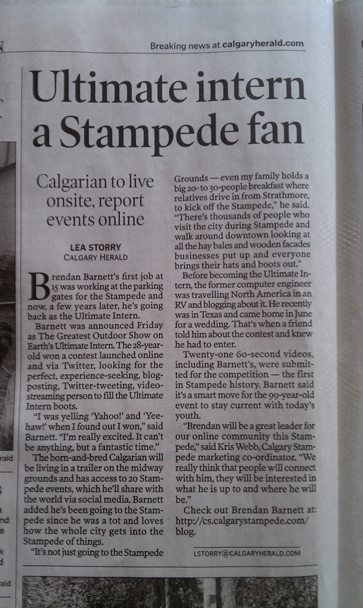
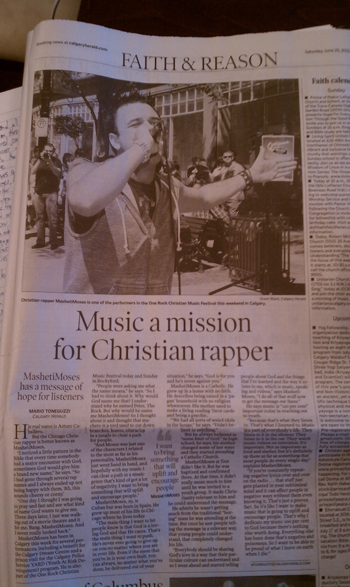

+++
published_at = "2011-06-26T00:00:00-07:00"
title = "Calgary Stampede 2011: Interview with the paper"
wayback_machine_url = "https://web.archive.org/web/20120301151505/http://blimpyb.com/calgary-stampede-2011/calgary-stampede-2011-interview-with-the-paper/4118/"
+++

# Calgary Stampede 2011: Interview with the paper

“I have a mission for you, should you chose to accept it” the Calgary Herald reporter asked over the phone.

“Will my computer explode in 5 seconds if I do?” I quipped back.

<figure>
    
    <figcaption><strong>That's me!</strong></figcaption>
</figure>

Her silent deadpan threw a wet blanket on what for me was a pretty sharp line, apparently she just wanted a headshot sent in for the article. “She” being Lea Storry, perhaps the best journalist name in history.

Not used to my newfound world of press handlers and having 12 minutes of dialogue distilled into 3 sentences of sound bites, I was [curious what the end result would be](https://web.archive.org/web/20120301151505/http://www.calgaryherald.com/technology/Ultimate+intern+Stampede/5005763/story.html). It’s more straightforward than what I’d write to tell my own story, but probably makes more sense given I [answer](https://web.archive.org/web/20120301151505/http://092.me/)ed “to get to the crossroads in the Mississippi river delta” as my motivation to sell everything I own and live in an RV. I suppose this is my fault as I’m trying to ease into my new role with kid gloves and held back my usual quotables like “I ain’t going to work on Maggie’s farm no more” or “outer space, think about it!”

<figure>
    
    <figcaption><strong>I ain't rappin for God, I ain't rappin for money</strong></figcaption>
</figure>

On the adjacent page in the paper is a twice as long life story of [some Christian rapper Arturo Caballero](https://web.archive.org/web/20120301151505/http://www2.canada.com/calgaryherald/news/city/story.html?id=a15244b2-4780-493b-a816-d2a0b1711958) who calls himself MashetiMoses, apparently given this “rap name” by God after fasting and praying. Too bad [I just finished four days of fasting in the desert](https://web.archive.org/web/20120301151505/http://blimpyb.com/random/the-blimpy-diet/4072/) and emerged named the exact same, otherwise I’d get more press.

I’m not sure if it was taken into account when selecting the Calgary Stampede 2011 intern contest winner, but you really do need to have a screw or two loose to want to live in an RV on the Stampede grounds for 10 days, and I’m in a pretty unique spot already living in an RV and being short more than a few marbles. While writing this at the breakfast table I came to the conclusion that if I get to interview Kevin Costner, I’m going to challenge him to a kung fu battle and overdub it poorly as a short film.

Presumably the Stampede’s goal with this internship is to get as much exposure as possible, and I figure I’ll best be able to help with that if I bring a bit of edge. But don’t worry, I’ll still be wearing pants for the TV interviews.
