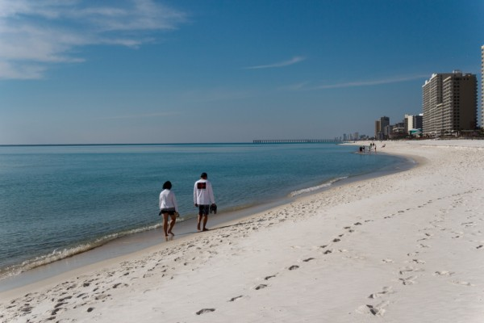

+++
published_at = "2012-02-10T00:00:00-08:00"
title = "Who’s Tom Petty?"
wayback_machine_url = "https://web.archive.org/web/20130918025707/http://blimpyb.com/photography/whos-tom-petty/4513/"
+++

# Who’s Tom Petty?

Yes, someone actually asked me that. We were talking about concerts we’d been to and I referenced him at the once-of Pemberton Festival in Canada, and just got a blank stare. I’m not sure if it’s worse or better that I followed up, eyebrow raised with “y’know…Last Dance With Mary Jane…Free Fallin’?” and got “oh yeah, sure I know those” without pressing to verify they weren’t just saying that to get the horrified look off my face.

<figure>
    
    <figcaption><strong>Fine, I'll just go listen to Tom Petty by myself!</strong></figcaption>
</figure>

I believe it was Plato who famously complained about the youths these days, and having been proven wrong over thousands of years it’s something I make a conscious effort to try not to say or believe even if deep down I sympathize. Being in the college town of Gainesville, home to the University of Florida (yes, Tim Tebow’s alma matter, we’ll skip that commentary here) I figured it only made sense to CouchSurf with some college kids, so I broke my rule of not seeking out people more than 5 years my junior. Oh I don’t regret it, we went to an Oregon Trail themed party and a rager house party with 50 people at a three bedroom house mainly spilling out onto the street. There was even a dude with a mullet and a shirt that read GAINESVILLE FUCKING FLORIDA!

However, because this is the American south, the term we use in Canada called “student ghetto” still applies, but in a literal sense. A transient kid population just looking for a cheap place to live begets slum lords, rundown properties and depressed values, which in turn causes actual riff raff to move in. I didn’t really think much of some of the neighbours coming over and crashing the party, other than laughing that kids had the audacity to complain when there was blaring music and 40 people blocking the street at two in the morning. Soon enough someone had ordered a Jimmy John sandwich, the delivery boy propped his bike on the side of the house when he went in to deliver it, then found it gone when he came back outside. Quickly borrowing someone else’s bike to search for his own, after some minutes he angrily sped back towards the full crowd, someone stepped in his way and he totally wiped in front of all the cool kids and threw his helmet against the wall screaming he would shit in their sandwich if they ever ordered one to that house again.

---

“What’s espresso?”

For some reason this question from the person in front of me in line brought a beaming grin to my face, unlike the Tom Petty inquiry. It was in response to the scripted sales pitch at McDonald’s for their new McCafe deal, and if it wasn’t for the piece of paper to answer, I’m pretty sure the cashier didn’t know either. By this point in time I was in the absolute middle of nowhere in the Florida panhandle, returning from another adventure of camping in the middle of nowhere (best spot ever FYI, check [the gallery](https://web.archive.org/web/20130918025707/http://blimpyb.com/gallery/florida-panhandle/)). It was the only McDonald’s for 50 miles in any direction, there probably wasn’t a Starbucks, or for that matter an espresso maker for at least 100, and I’m not sure why, but I like that, even though I like espresso, and Starbucks.

<figure>
    
    <figcaption><strong>The Gulf</strong></figcaption>
</figure>

What I didn’t like was hearing the 6 year old kid in the booth next to me make reference to “the 51 states” and not be corrected by her mother. I mean, maybe Puerto Rico counts because this is Florida, but these were white country folks in the panhandle. Somehow miraculously diffusing the reaction growing in my mind was the fact I was drawn into it as the mother turned to me and asked while pointing to the parking lot “what state does that license plate say, New York?” It was very far away, but I have fighter pilot vision and have been able to beat anyone reading the letters at a distance since I was a child, so after a brief squint I informed her “no ma’am, Michigan”. Thank God Bessie was out of view so we didn’t have to get into which state Alberta was.
