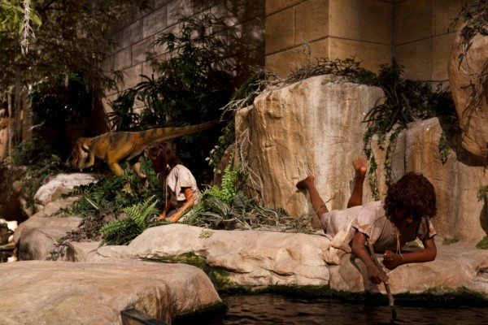
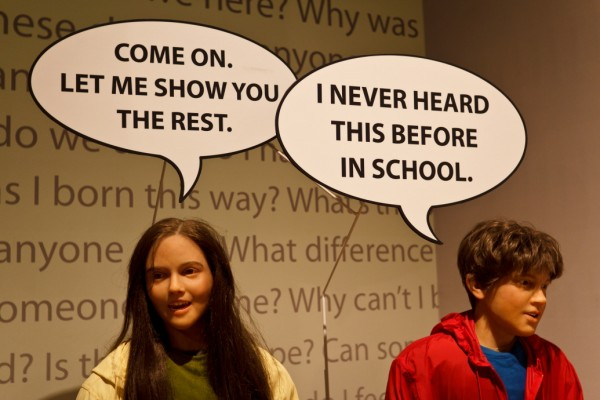

+++
published_at = "2012-10-02T00:00:00-07:00"
title = "Those Crazy Creationists"
wayback_machine_url = "https://web.archive.org/web/20140110021104/http://blimpyb.com/random/those-crazy-creationists/4680/"
+++

# Those Crazy Creationists

God differentiated hundreds of species of finches in the Galapagos because it makes him angry when we put it in the butt. If A, then B, it’s simple logic people.

    <figure>
        
        <figcaption><strong>Dinosaurs and people, together in harmony</strong></figcaption>
    </figure>

Of course in more recent times than the 6000 years ago when the earth was created, books actually attributable to their authors would declare God is dead, so I guess it’s all a matter of what you choose to believe. And at the Creation Museum in Florence Kentucky, judging by the fact it’s run by an organization called Origins In Genesis, what they believe is pretty clear.

For anyone who’s seen Religulous where Bill Maher visits and rightfully skewers the place, well, it’s exactly as he described. Man and dinosaur living together as one, the entire earth actually being covered by the great flood, plenty of goofy placards explaining why man knows nothing beyond the unquestionable word of God in the Bible, how modern society is descending into sin, all that fun stuff.

    <figure>
        
        <figcaption><strong>Gotta get 'em while they're young</strong></figcaption>
    </figure>

Funny thing is, I wasn’t really bothered by all of it, not that I expected I’d start yelling at random people that the Bible is fiction and they are all insane, but it was kind of a pleasant place. Everyone who worked there was really friendly, the exhibits did mention things like the big bang, evolution and plate techtonics, just that they were wrong because they weren’t in the Bible. It was kind of quirky and cute, really.

There were also really nice grounds and a petting zoo, although I skipped that part. However, Phase 2 of the museum is to build a life-sized recreation of Noah’s Arc, and if you donate now you can get a ticket in case flood number two happens! Sounds like money well spent to me!

Here’s [the gallery](https://web.archive.org/web/20140110021104/http://blimpyb.com/gallery/creation-museum/).
